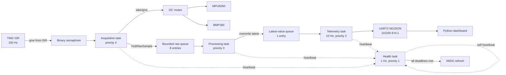

# Architecture and design decisions

The ISR never performs I2C or formatting. It only signals work and requests a
context switch when appropriate. A binary semaphore intentionally coalesces
late ticks instead of creating an unbounded backlog; every coalesced tick is
reported as `sample_tick_overruns`.

## Task model and invariants

| Task | Period / trigger | Responsibility | Health deadline |
|---|---|---|---:|
| Acquisition | TIM2 semaphore, 10 ms | Read both sensors, update online state and I2C counters, enqueue raw sample | 30 ms |
| Processing | raw queue | Scale IMU data, compensate barometer data, calculate altitude, publish latest sample | 100 ms |
| Telemetry | 100 ms | Snapshot counters, encode one bounded NDJSON frame, transmit UART | 250 ms |
| Health | 1 s | Check all heartbeats; feed or intentionally withhold IWDG | 1500 ms |

Key invariants:

- Every I2C operation acquires the same mutex once, holds it across all retry
  attempts, and releases it on success or terminal failure.
- Queue operations never block acquisition. A full raw queue increments a drop
  counter; processed telemetry uses overwrite-latest semantics so consumers see
  the freshest state.
- A sensor becomes offline only after three consecutive failed acquisition
  cycles, preventing a single transient NACK from flapping status.
- Sensor failure does not imply task failure. The watchdog stays eligible while
  tasks are scheduling and reporting the degraded sensor state.
- A missing task heartbeat withholds refresh; the independent hardware watchdog
  is then expected to reset the MCU.
- On target, DWT measurements are unsigned cycle deltas, so one counter wrap is
  safe for these short measured regions.

## Design decisions

- **Integer BMP280 compensation:** follows the datasheet algorithm and is tested
  against its published calibration/raw vector. Floating point is used only in
  the lower-priority processing stage for human-readable units and altitude.
- **Retry inside one mutex hold:** prevents another task from interleaving a
  transaction between attempts and keeps error accounting at the operation
  boundary. The 5 ms HAL timeout bounds each attempt.
- **Latest-value telemetry:** UART reporting should not force acquisition to
  replay stale data. A one-slot overwrite queue makes the policy explicit.
- **NDJSON instead of a binary protocol:** at 10 Hz and 115200 baud, readability
  and easy capture outweigh bandwidth. The formatter uses a fixed buffer and
  rejects truncation.
- **Blocking UART in the adapter:** bounded 10 Hz transmission keeps the example
  easy to integrate. DMA with a dedicated TX queue is the next step if UART
  latency is significant in measured target timing.
- **Host simulation over mocked RTOS threads:** deterministic millisecond event
  scheduling makes fault regressions exact and fast. It models scheduling
  contracts, not FreeRTOS kernel internals.
